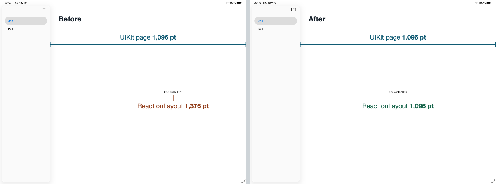

# Pinned sidebar width on iPad

Two native tabs each contain one flex view. React displays the view’s `onLayout` width. The **Measure UIKit page** button reads `selectedViewController.view.bounds.width` independently.



The annotations use the UIKit and React readings recorded with the original iPad screenshots.

## Run

Use Xcode, CocoaPods, and Yarn 1 with an iPad simulator. Run these commands from this directory.

```sh
yarn install --frozen-lockfile
yarn bundle
(cd ios && pod install)
open ios/FrameProbe.xcworkspace
```

Run **FrameProbe** on a full-screen 13-inch iPad Pro in landscape. Use **Toggle sidebar** to close the sidebar if already open. Open it beside the page, then tap **Measure UIKit page**. Close it and measure again. If a Debug build shows React Native’s optional sample-module alert at startup, dismiss it or select the Release configuration.

| iPadOS 26.5, sidebar pinned | UIKit page | React onLayout |
| --- | ---: | ---: |
| Screens 4.30.1 | 1,096 pt | 1,376 pt |
| With the fix | 1,096 pt | 1,096 pt |

To run the same app with the fix, apply the patch from this directory, regenerate the native component, and rebuild.

```sh
git apply tab-size.patch
(cd ios && pod install)
```

The example pins React Native 0.88.1 and React Native Screens 4.30.1. The native measurement and sidebar controls are in `ios/main.mm`. The React view is in `index.js`.
